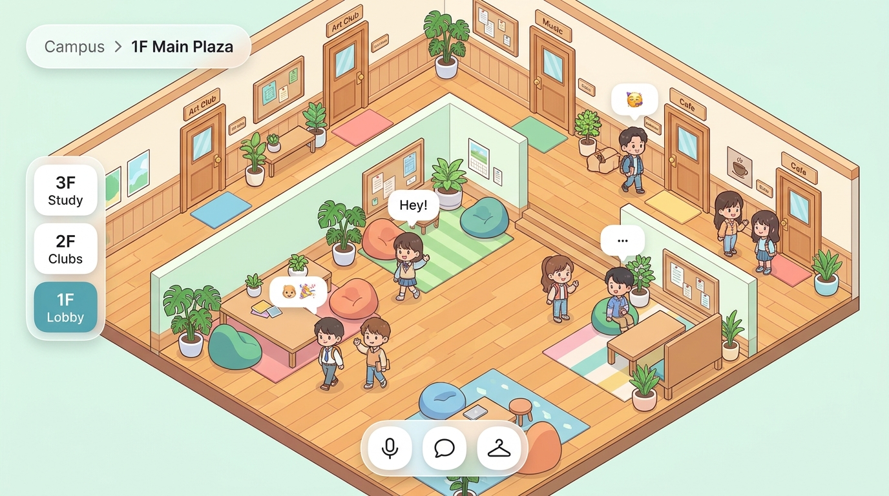
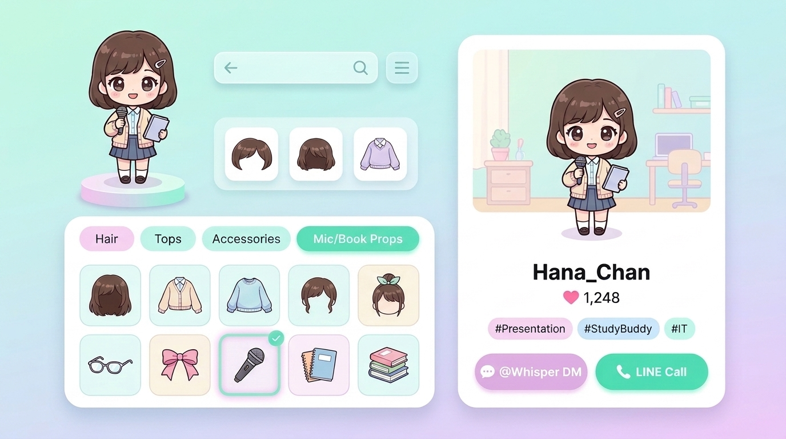
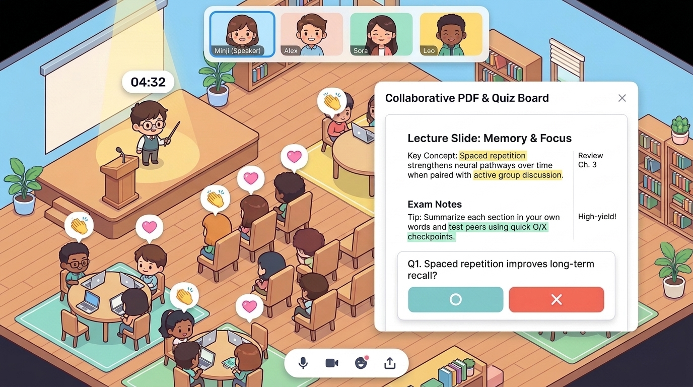

# Virtual Campus & Presentation Hub (แนวคิดโปรเจกต์ฉบับเต็ม)

> **Live Website:** [https://kitnongton01.github.io/virtual-campus-pitch/](https://kitnongton01.github.io/virtual-campus-pitch/)  
> **GitHub Repository:** [https://github.com/kitnongton01/virtual-campus-pitch](https://github.com/kitnongton01/virtual-campus-pitch)

---

## 1. ภาพรวมและคอนเซปต์หลัก (Core Concept)

**"Virtual Student Hub & Stage"** คือ แพลตฟอร์มคอมมูนิตี้บนเว็บแบบ 2.5D Isometric (ผสมผสานระหว่าง LINE PLAY, Gather.town และ ZEP) ที่จำลอง **ตึกกิจกรรม มหาวิทยาลัย ชมรม และห้องติว** เพื่อให้นักเรียน/นักศึกษาเข้ามาสร้างอวตาร หาเพื่อนที่มีความชอบตรงกัน ติวข้อสอบผ่านการแชร์ไฟล์ PDF และมี **เวทีจำลองสำหรับฝึกซ้อมพรีเซนต์งานจริง**

```
+-----------------------------------------------------------------------------------+
|                            VIRTUAL CAMPUS ECOSYSTEM                               |
+-----------------------------------------------------------------------------------+
|  [LINE PLAY Inspiration]      [Gather.town Inspiration]       [ZEP Inspiration]   |
|  - อวตาร 2D Chibi Layered     - ตึกจำลอง & ชั้น 1F/2F/3F       - ยัดไฟล์ PDF ติว   |
|  - ตู้เสื้อผ้า & ไอเทมถือ       - เวที Spotlight + ไมค์/จับเวลา  - Collaborative Pen |
|  - Profile Card & แท็กความชอบ   - Proximity Voice โซนโต๊ะ       - มินิเกม Quiz O/X  |
|  - Speech Bubble & @DM        - ตามหาเพื่อน & Warp             - โหมดแต่งห้อง Grid |
+-----------------------------------------------------------------------------------+
```

---

## 2. ฟีเจอร์หลักแบ่งตามหมวดหมู่ (Feature Breakdown)

### 🏢 โครงสร้างตึก ชมรม ห้อง และการระบุตำแหน่ง (Building & Spatial Architecture)


1. **ระบบตึกหลายชั้น (Floor Switcher):**
   * **1F Lobby & Plaza:** ลานรวมพลกลางแจ้ง บอร์ดประกาศหาเพื่อนติว/ซ้อมพรีเซนต์ และร้านค้าแลกชุด
   * **2F โซนชมรม (Clubs):** ประตูห้องชมรมพร้อมป้ายชื่อและหัวหน้าชมรม (เช่น ชมรมฝึกพรีเซนต์, สายวิทย์-คณิต, ภาษา, เล่นบอร์ดเกม)
   * **3F ห้องติวและเวทีซ้อม (Study & Presentation):** หอประชุมใหญ่สำหรับซ้อมพรีเซนต์ และห้องติวกลุ่มย่อย (4–8 คน)
2. **การระบุตำแหน่ง (Location & Breadcrumbs):**
   * แสดงพิกัดชัดเจน เช่น `📍 ตึกกลาง > ชั้น 2 > ห้องชมรมฝึกพรีเซนต์ (โต๊ะ B)`
   * ค้นหาเพื่อนในตึกแล้วกดปุ่ม **"Warp / เดินตามไปหา"** ได้ทันที
3. **ระบบสร้างและตกแต่งห้อง (Room Builder):**
   * หัวหน้าห้องสามารถเปิดโหมดตกแต่งห้อง (Edit Mode) ลากวางโต๊ะ โซฟา เวที กระดาน แบบ Grid-tile snap
   * ตั้งค่าห้อง: เปิดสาธารณะ / ใส่รหัสผ่าน / กำหนดแท็กประจำห้อง เช่น `#ติวแคลคูลัส`

---

### 🧑‍🎨 อวตาร ไอเทมแต่งตัว & โปรไฟล์เชื่อมความชอบ (Avatar & Social Profile)


1. **อวตาร 2D Chibi แต่งตัวได้ (สไตล์ LINE PLAY):**
   * อวตารแบบแยกเลเยอร์: โครงหน้า, ทรงผม, เสื้อผ้า, กางเกง/กระโปรง, รองเท้า, เครื่องประดับ, สัตว์เลี้ยง
   * **ของถือแสดงตัวตน (Handheld Props):** ไมโครโฟน, หนังสือสรุป, แฟ้มเอกสาร, แท็บเล็ต, แก้วกาแฟ
2. **ระบบเศรษฐกิจและแต้มรางวัล (Gamification):**
   * ได้รับเหรียญ / หัวใจ (`♥`) เมื่อ:
     * ขึ้นเวทีซ้อมพรีเซนต์จนครบเวลา
     * อัปโหลดชีทสรุป PDF แล้วมีเพื่อนกดบันทึกหรือกดถูกใจ
     * เช็กอินเข้าห้องติวสม่ำเสมอ
3. **โปรไฟล์และการเชื่อมความชอบ (Smart Profile Card):**
   * คลิกดูโปรไฟล์เพื่อน แสดงรูปอวตารเต็มตัว, สถิติการซ้อม, และแท็กความชอบ
   * **Onboarding Questions:** ถามความชอบ (เป้าหมาย, วิชาที่ถนัด, งานอดิเรก, สไตล์การเรียน) นำข้อมูลไปจับคู่หาเพื่อนและแนะนำห้องชมรมที่ตรงจริต
4. **ระบบสื่อสารและการเชื่อมต่อ LINE:**
   * **In-Game Chat:** พิมพ์ข้อความแล้วลอยเป็น Speech Bubble เหนือหัวตัวละคร
   * **@DM ส่วนตัว:** พิมพ์ `@username` เพื่อกระซิบส่งข้อความส่วนตัว ไม่รบกวนคนอื่น
   * **ปุ่มโทร/คุยต่อใน LINE:** มีปุ่ม Quick Link ให้ดีดไปเปิดแช็ตหรือโทรต่อใน LINE ส่วนตัวได้ทันที

---

### 🎙️ เวทีฝึกพรีเซนต์ & ห้องติวข้อสอบ PDF (Presentation Arena & Study Room)


1. **เวทีฝึกพรีเซนต์ (Stage Mode & Spotlight):**
   * **Broadcast Mode:** ผู้ที่ก้าวขึ้นเวที (Podium) เสียง สไลด์ และกล้องจะถูกกระจายไปยังทุกคนในห้อง
   * **Presentation Timer:** นาฬิกาจับเวลาถอยหลัง (เช่น 5 นาที / 10 นาที) พร้อมเสียงเตือนเมื่อใกล้หมดเวลา
   * **Audience Reactions:** ผู้ชมนั่งฟังสามารถกดรีแอ็กชันลอยขึ้น (👏 ปรบมือ, 🙋 ยกมือถาม, ❤️ หัวใจ) และให้ Feedback คะแนนหลังซ้อมเสร็จ
2. **ระบบยัดไฟล์ PDF ติวข้อสอบ (Collaborative PDF Locker):**
   * ลากไฟล์ PDF (ชีทสรุป, แนวข้อสอบ, สไลด์) แปะไว้บนไวท์บอร์ดกลางห้อง
   * สมาชิกในห้องเปิดอ่านไปพร้อมกัน (Sync Page), ใช้ Laser Pointer ชี้จุดสำคัญ และใช้ปากกาไฮไลต์ข้อความแบบเรียลไทม์
3. **มินิเกมติวข้อสอบ (Quiz Arena แบบ ZEP):**
   * **Quiz Modal:** ป๊อปอัปคำถาม O/X หรือ ช้อยส์ A/B/C/D ให้ทุกคนในโต๊ะกดตอบ แข่งขันกันพร้อมเฉลย
   * **Spatial O/X Zone:** ให้อวตารวิ่งไปยืนในโซนคำตอบที่คิดว่าถูกต้อง เพิ่มความสนุกในการติว

---

## 3. สรุปโครงสร้างการจัดวางหน้าจอ (Web UI Layout)

| พื้นที่หน้าจอ | หน้าที่และองค์ประกอบ |
| :--- | :--- |
| **Canvas กลางจอ (80%+)** | แผนที่ตึก 2.5D, ตัวละครเดินอิสระ, Speech Bubble ลอยเหนือหัว |
| **แถบซ้าย (Navigation)** | ปุ่มสลับชั้น (`1F`, `2F`, `3F`), พิกัดตำแหน่งปัจจุบัน (`ตึกกลาง > ชั้น 2`), ปุ่ม Warp |
| **แถบบน (Media Strip)** | วิดีโอกล้องผู้พูดบนเวที และปุ่มเปิด/สลับดูเอกสาร PDF ที่ติวอยู่ |
| **แถบล่าง (Floating Dock)** | ปุ่มไมค์/กล้อง, อีโมต, ช่องแช็ต & `@DM`, ตู้เสื้อผ้า (Closet), ปุ่มแต่งห้อง |

---

## 4. แผนการพัฒนา (MVP Roadmap)

```
[Phase 1: Core MVP] ──► [Phase 2: Social & Avatar] ──► [Phase 3: Ecosystem]
 - แผนที่ Canvas 2D       - แต่งตัวอวตาร Layered 2D      - ตึกหลายชั้น & แต่งห้อง
 - เสียง WebRTC เวที      - Profile Card & แท็กความชอบ   - มินิเกม Quiz ข้อสอบ
 - ซ้อมพรีเซนต์ + PDF      - Speech Bubble & @DM          - เชื่อมต่อ LINE API
```

---
*เอกสารนี้จัดทำขึ้นเพื่อใช้เป็นพิมพ์เขียว (Blueprint) และ Presentation Pitch สำหรับโครงการ Virtual Campus & Presentation Hub*
